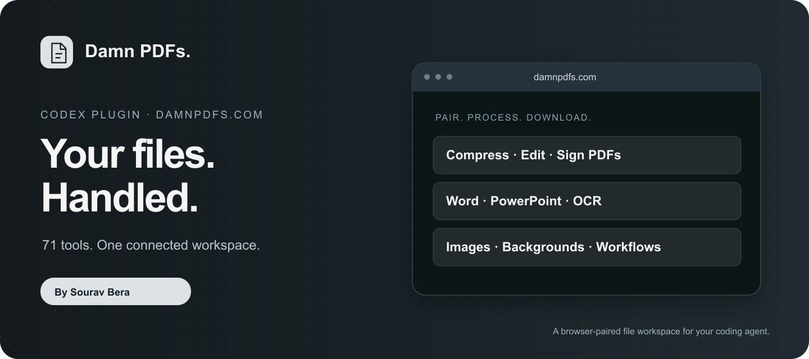

# Damn PDFs by Sourav Bera



Connect Codex to your approved [DamnPDFs](https://damnpdfs.com/) browser workspace. **71 file tools** for PDFs, Office documents, images and audio, with individual MCP operations, local file import/export and guided workflows.

## Install in Codex

In **Plugins → Add → Add a marketplace**, enter:

```text
SouravBeraAkaSpeed/damnpdfs-codex-plugin
```

Choose **Damn PDFs by Sourav Bera** and install. The equivalent CLI commands are:

```sh
codex plugin marketplace add SouravBeraAkaSpeed/damnpdfs-codex-plugin --ref main
codex plugin add damnpdfs@damnpdfs
```

Alternatively, download `damnpdfs-1.0.0.zip` from [Releases](https://github.com/SouravBeraAkaSpeed/damnpdfs-codex-plugin/releases) and use **Add → Upload plugin archive**. Start a new Codex chat after installation so the plugin's skills and MCP tools are loaded. Node.js **22 or later** must be available as `node`.

This is a public Git-backed Codex marketplace. Adding this source makes the plugin installable; it does not mean it has been selected for the default Public/featured directory.

## First safe prompt

> Connect DamnPDFs to a new empty browser workspace. Show the connection status and available tool count before uploading any files.

Open [damnpdfs.com](https://damnpdfs.com/), select **Agent access**, create a code and pair it using `connect_browser`. With browser control available, Codex can read the code from the approved tab. No API key, OpenAI API account verification or persistent token file is needed. Only the temporary pairing code is accepted; never provide a password, provider key or browser cookie.

Then try:

- “Compress this PDF for email, compare the sizes and save a new copy.”
- “Convert this PowerPoint to PDF and merge it after this document.”
- “Compress these PNG images while keeping transparency.”
- “Inspect page two, replace this word, and verify the downloaded PDF.”

## How it works

The dependency-free Node.js stdio bridge exposes **71 task tools, eight workspace operations and five connection/file helpers**. It forwards authorized requests through the same browser execution bridge used by DamnPDFs WebMCP. Optional native WebMCP support is not required for this HTTPS pairing path. The browser tab stays open and executes the task; this is not an unattended cloud automation service.

Session credentials stay in bridge process memory. A session initially lasts two hours and can renew while its paired tab remains connected with auto-renewal enabled. Revocation or expiry requires pairing again. File retention does not extend with session renewal.

## Permissions and data boundaries

- **Read:** only workspace files and exact local paths selected or approved for the task. There is no filesystem search, Codex history access, cookie access or credential-file import.
- **Write:** create requested output files with exclusive creation; existing files are never overwritten by the export helper. Workspace cleanup, cancellation and revocation are separately labelled destructive operations.
- **Network:** only `https://api.damnpdfs.com`; local file imports upload selected bytes to temporary cloud storage. Browser-only uploads can use the website directly. Native conversions/compression use the existing temporary cloud workers. External AI needs provider settings entered by the user directly in the website.
- **Retention:** browser document copies at most four hours; temporary cloud copies at most one hour or earlier acknowledged cleanup. User-saved downloads remain under user control. The bridge adds no analytics, credentials on disk, scheduled visits, advertisements or background browsing. Website measurement is described in its [privacy policy](https://damnpdfs.com/privacy).
- **Limitations:** a connected tab is required, one operation runs at a time, originals are preserved, scanned text may need OCR, missing fonts may affect Office conversions, and a visible PDF signature is not certificate signing. Check actual outputs and warnings.

More details: [plugin setup](plugins/damnpdfs/README.md), [privacy](https://damnpdfs.com/privacy), [terms](https://damnpdfs.com/terms), [help/contact](https://damnpdfs.com/contact), [tool guides](https://damnpdfs.com/guides).

## Inspect, test and update

No dependency installation is needed for the plugin or tests:

```sh
node --test tests/*.test.mjs
node scripts/validate.mjs
node scripts/pack.mjs
```

`catalog_check` checks public schema drift without uploading documents. `codex plugin marketplace upgrade damnpdfs` refreshes the source; reinstall with `codex plugin add damnpdfs@damnpdfs`, then use a new chat. [Report issues](https://github.com/SouravBeraAkaSpeed/damnpdfs-codex-plugin/issues) without attaching private documents, credentials or pairing codes.

The MIT license covers this plugin package, not an ownership transfer of user documents or the hosted service. Independent integration by Sourav Bera; no claim of OpenAI endorsement.
